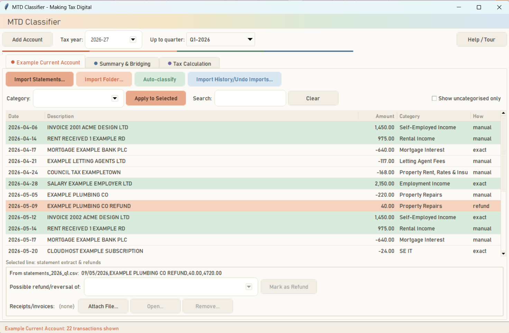
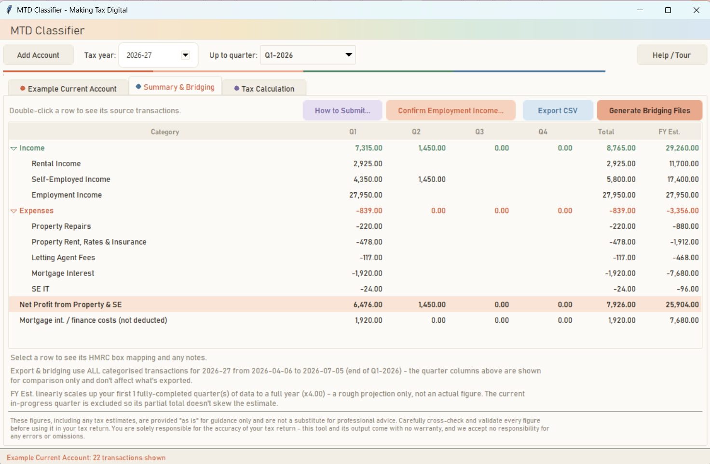
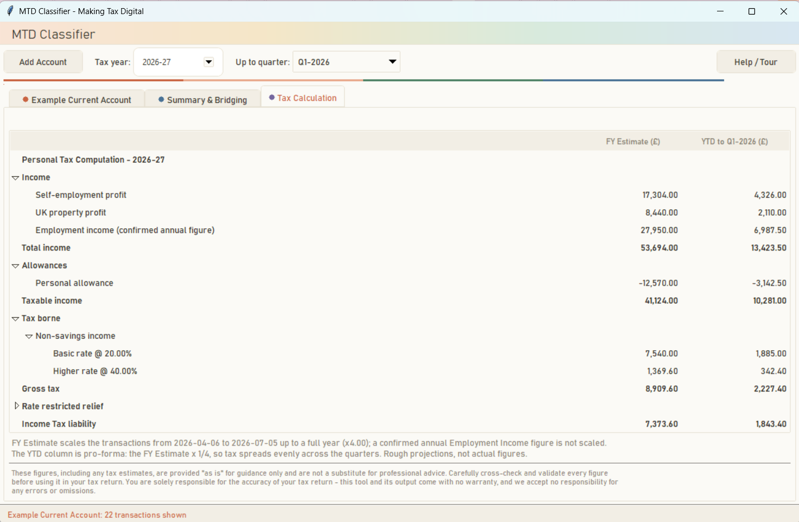
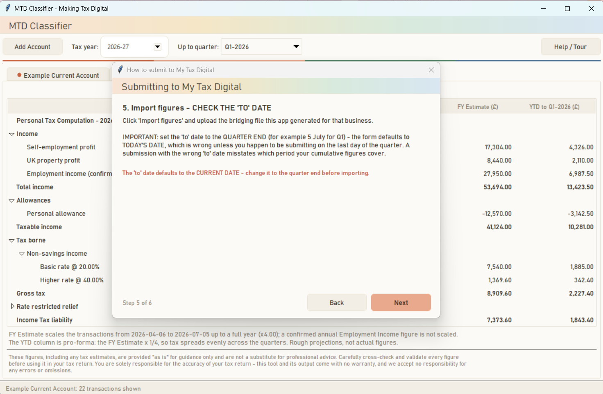

# MTD Classifier

An open-source (GPL-3.0) **Making Tax Digital companion** for UK sole traders and
landlords. It turns your bank statements into the cumulative quarterly figures HMRC
requires, and writes them into spreadsheets in the exact format required by free
bridging software such as [MyTaxDigital.com](https://mytaxdigital.co.uk) — so you can
review, upload, and submit without paying for MTD software or an accountant.

I used it for my own MTD Income Tax Q1 2026-27 submission, cross-checked every figure,
and in my circumstances it worked correctly. With this plus the My Tax Digital website,
I didn't need to pay my accountant to do MTD for me.

**MTD Classifier is an independent project.** It is not affiliated with, or endorsed
by, HMRC or My Tax Digital (a free service by Open Answers Ltd) — it simply produces
files in the format their bridging import accepts.

## ⚠️ Provided as-is — cross-check everything

This software is provided **as-is, with no warranty of any kind**. Until it has proven
itself for *your* use case, make sure **every figure is cross-checked and verified
correct before submitting anything to HMRC**. The authors are **not responsible for any
errors or omissions**. The app is built to make that cross-checking easy (double-click
any total to see the exact transactions behind it, and it warns you when a period's
statements can't be verified as complete) — use those features before every submission.

## Screenshots

All screenshots show invented example data.

### The transaction ledger



One consolidated, colour-coded list per bank account: money in is green, refunds are
highlighted and net against the original's HMRC box, and uncategorised lines stay
yellow until you deal with them. Type in the search box to filter as you type, click
any column heading to sort, and right-click a line for the quick menu — filter to
similar transactions, categorise (with HMRC guidance tooltips on hover), pair a
refund, mark an expense disallowable, or delete. The panel below shows the original
statement line behind whatever you select, plus receipt attachments.

### Summary & Bridging



Your quarterly totals per HMRC box across all accounts, with a full-year projection
column. Double-click any figure to drill into the exact transactions behind it — the
cross-checking tool you should use before every submission. The toolbar's
"Up to quarter" selector drives the cumulative export, and greys out quarters whose
data isn't complete yet. "Generate Bridging Files" writes the My Tax Digital
templates from here.

### Tax Calculation



A full personal tax computation in the style of an accountant's printout — income by
source, personal allowance (with taper), tax bands, mortgage-interest relief and
Class 2/4 NIC — as a full-year estimate plus a pro-forma year-to-date share.

### Guided submission



The "How to Submit" walkthrough opens after generating bridging files (skippable) and
covers the whole My Tax Digital flow, including the two traps that catch people: the
upload's "to" date defaulting to today instead of the quarter end, and the fact that
a submitted obligation cannot be amended.

## What it does

- **Imports bank statements** in CSV, OFX, XLSX, XLS (including the HTML-tables-saved-as-
  .xls that some banks call "Excel"), and text-based PDF formats. Unrecognised tabular
  layouts go through a guided column-mapping dialog and are remembered. Re-importing is
  safe: files and duplicate transactions are detected and skipped, and imports can be
  undone.
- **Categorises transactions** against the full SA103F (self-employment) and SA105
  (UK property) box sets — including allowable/disallowable expense splits, tax deducted
  at source (CIS / Non-resident Landlord), and automatic Rent-a-Room exemption
  derivation. Hover any category for condensed HMRC guidance on what belongs in it.
- **Auto-classify learns from you.** Every category you set by hand becomes a rule, so
  after you've classified one "PLUMBER J SMITH" the next hundred classify themselves.
  In my experience this is the feature that saves the most time.
- **Verifies completeness** before HMRC output: an unbroken running-balance chain, or
  agreement between two independent sources (PDF statements vs CSV/XLS exports), proves
  a quarter's data is complete.
- **Generates bridging spreadsheets** — the official My Tax Digital SA103/SA105
  templates filled with cumulative year-to-date figures (HMRC requires cumulative, not
  per-quarter), including the disallowable-expenses column. The templates are My Tax
  Digital's own files (HMRC publishes no bridging templates), so they are not bundled:
  the app downloads them from mytaxdigital.co.uk on first use (internet needed once),
  caches them, and verifies them against a pinned SHA-256 — if the vendor ever changes
  the template layout, the export stops and asks for an app update instead of risking
  figures landing in the wrong boxes.
- **Estimates your tax** with a full personal computation (all income sources, personal
  allowance taper, mortgage-interest relief phase-in, Gift Aid band widening,
  Class 2/4 NIC) using verified historical rates back to 2006-07.
- **Guides you through submission**: a first-run tour of the app, and a step-by-step
  "How to Submit" walkthrough covering registering your businesses with HMRC, Bridging
  mode, picking the right obligation, and the traps (the upload's "to" date defaults to
  today instead of the quarter end; a submitted obligation cannot be amended).
- **Keeps users separate**: multiple users, each with fully isolated data, and receipt/
  invoice attachments per transaction.

## What it does NOT do

- **No VAT.** It only calculates **self-employment and property income tax** figures
  for MTD for Income Tax.
- It does not submit to HMRC directly — it produces the spreadsheets you upload through
  bridging software (that's the point: the bridging layer stays free).
- Employment income, interest, dividends and Gift Aid are tracked for the year-end
  final declaration and the in-app tax estimate, but are never part of quarterly
  updates (HMRC already gets employment income via PAYE).

## Getting started

### Windows installer (no Python required)

Download `mtd-classifier-setup-<version>.exe` from the
[releases page](https://github.com/scotjam/mtd-classifier/releases) and run it.
It installs per-user (no admin rights needed), bundles everything including Python,
adds a Start Menu entry, and uninstalls cleanly from Settings → Apps — your data in
`~/.mtd-classifier` survives an uninstall or upgrade. Tested on Windows 11.

To build the installer yourself: install a python.org CPython 3.10+ and Inno Setup 6
(`winget install JRSoftware.InnoSetup`), then run
`powershell -ExecutionPolicy Bypass -File installer\build_installer.ps1`.

### From source

Requires Python 3.10+ (developed on Windows; it's plain Python + Tkinter, so porting
to Linux/macOS would not be hard — it just hasn't been tested there).

```
git clone https://github.com/scotjam/mtd-classifier
cd mtd-classifier
pip install -e .
pip install pillow   # optional: nicer rounded UI surfaces
mtd-gui
```

On Windows you can also just double-click `launch_gui.bat`, which installs and launches
in one step. A detailed interactive tutorial runs on first launch (re-run it any time
from the Help button), and there's a CLI too — try `mtd --help`.

The typical quarter: import your statements (or point "Import Folder..." at a folder of
them) → Auto-classify → review the highlighted uncategorised lines → check the Summary
tab → Generate Bridging Files → follow the How to Submit guide → cross-check every
figure on the My Tax Digital review screen against the Summary tab → Submit.

## Help improve PDF statement recognition

PDF import is heuristic — it reads date-prefixed lines from text-based PDFs and infers
each amount's sign from the balance movement — and how well it works varies by bank.
**Real PDF statements are what improve it.** If PDF recognition is spotty for your
bank, consider submitting a sample statement (open an issue to arrange it).

**Please only submit statements whose contents are not sensitive.** Good candidates:
accounts that have already been shut down (or will be shortly), or accounts where you
hold nothing of value but there has been some past activity that you have determined
is not confidential. When in doubt, don't send it — and never submit a statement
containing information you consider private. Anything used to build a committed test
fixture gets its names, references, dates, amounts and balances altered first, but
that is a courtesy, not a substitute for your own judgement about what you share.

## License

[GPL-3.0](LICENSE). Contributions welcome.

## Donations

If this saved you some time or money, donations are very welcome:

**BTC:** `bc1qwafw8nxmjkr6p3tajmrqfdn2wnj93g9ysnydpk`

The installer is currently unsigned, so Windows SmartScreen shows an "unrecognized
app" warning on first run (click "More info" → "Run anyway"). If I get enough
donations I will buy a code-signing certificate, which — as signed downloads build
reputation with Microsoft — will over time get rid of the installation warnings.
Donations will also cover the ongoing subscription costs of keeping it signed.
